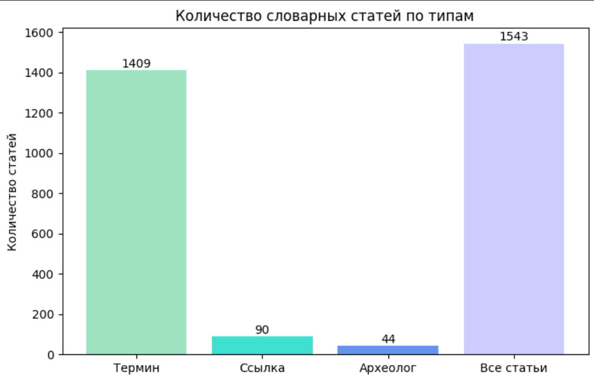
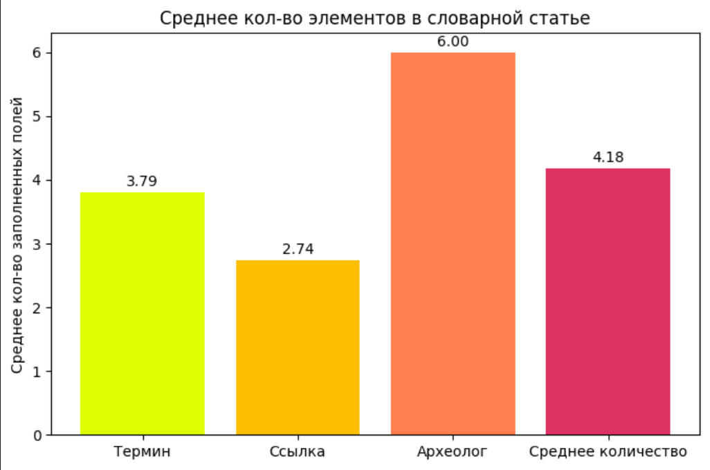
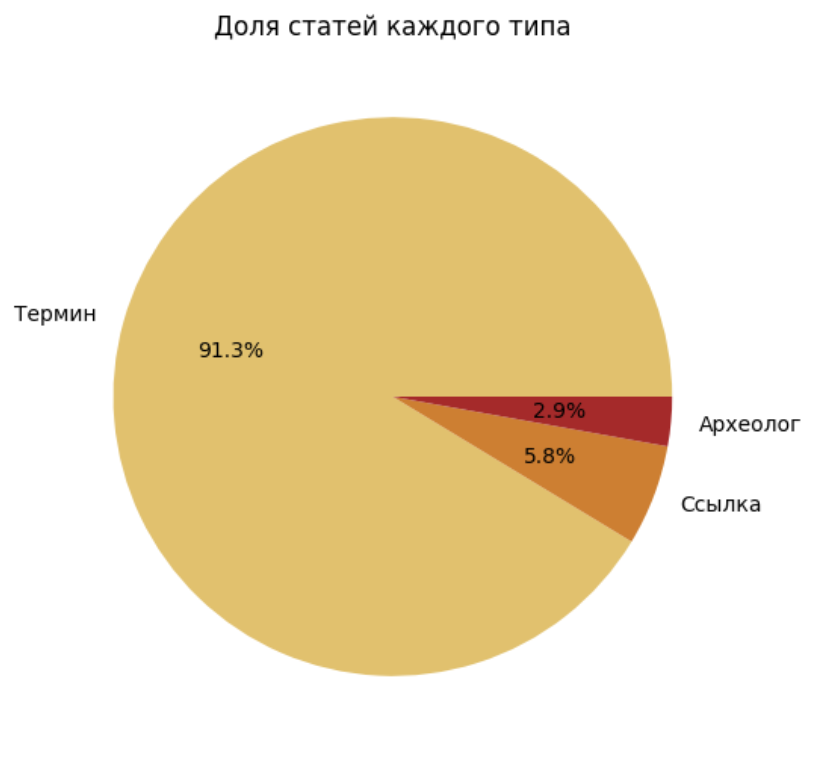

## Визуализационная часть проекта (Графики)

Визуализация в проекте выполняет роль аналитического слоя: она позволяет не только хранить словарные статьи в SQLite, но и оценивать структуру словаря, его объём и полноту заполнения полей. Скрипт подключается к базе `База 1.db`, выполняет агрегирующие SQL-запросы и строит три диаграммы с помощью `matplotlib`. Все значения подписаны прямо на графиках, поэтому результаты можно интерпретировать без дополнительных таблиц.

### Что показывает каждый график

**1. Количество словарных статей по типам**  
Столбчатая диаграмма показывает, сколько статей каждого типа хранится в базе: `Term`, `Link`, `Archaeologist`, а также общее количество статей. График позволяет быстро оценить объём словаря и соотношение между типами записей.

**2. Среднее количество элементов в словарной статье**  
Диаграмма характеризует полноту данных: для каждого типа статей рассчитывается среднее число заполненных полей. Для термина учитываются `word`, `latin`, `definition`, `extra_info`; для ссылки — `word`, `latin`, `link`; для археолога — `surname`, `surname_lat`, `name`, `years`, `achievements`, `extra_info`. Чем выше значение, тем полнее заполнены карточки. Отдельный столбец показывает среднее по трём типам статей.

**3. Доля статей каждого типа**  
Круговая диаграмма показывает пропорциональное распределение статей по типам. Она дополняет первый график: вместо абсолютных чисел здесь видно, какой тип записей преобладает в словаре.

