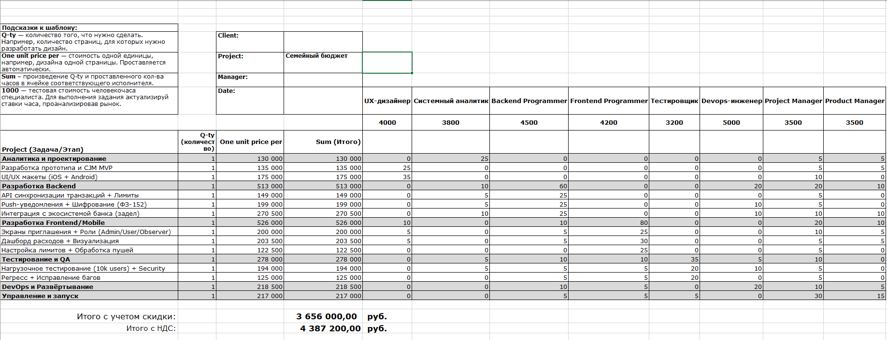
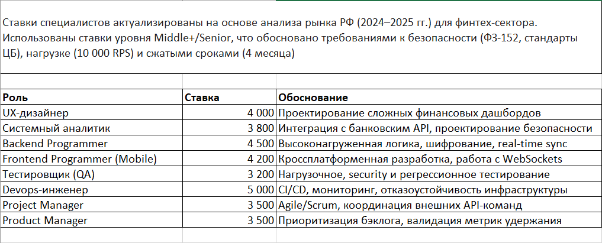
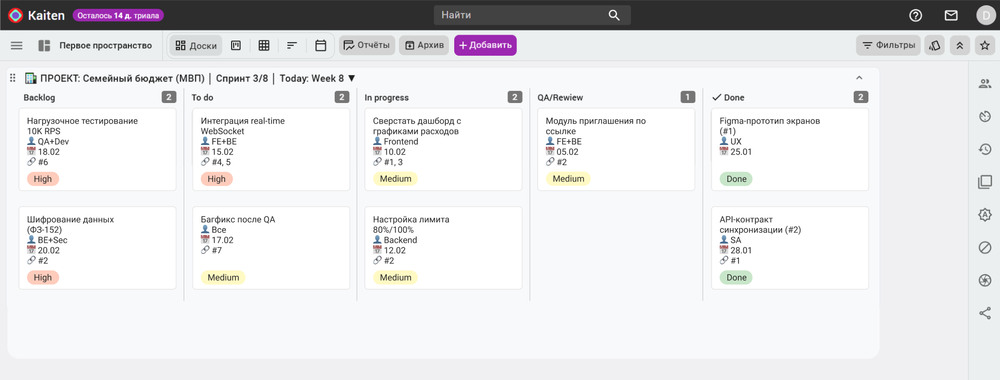
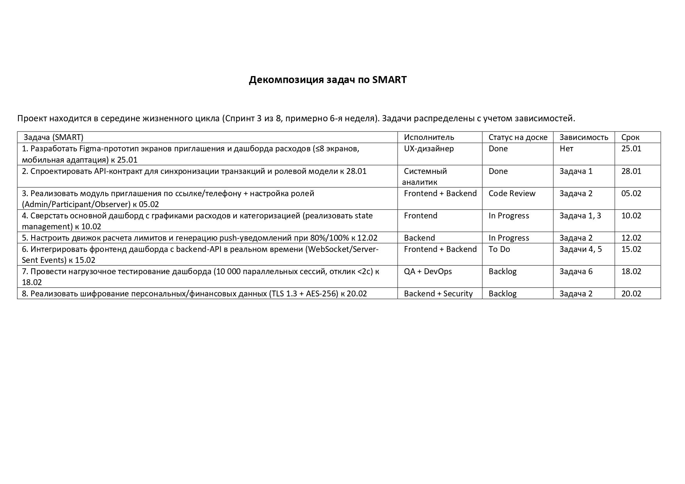

## Планирование проекта: «Семейный бюджет» (2026)

### 1. Бюджет проекта (смета и обоснование)
- **Инструмент:** Excel
- **Описание:** Рассчитана стоимость часа для 8 специалистов (UX/UI, аналитик, backend, frontend, QA, DevOps, PM, Product Manager) на основе рыночных ставок РФ 2024-2025 гг. для финтех-сектора. 

### 2. Доска проекта и декомпозиция (SMART)
- **Инструмент:** Kaiten
- **Описание:** Проект разбит на 8 задач по методологии SMART. Каждая задача имеет измеримый результат, дедлайн, ответственного и зависимости. Доска отражает середину жизненного цикла проекта (Спринт 3 из 8).

### 3. Диаграмма Ганта
- **Файл:** [Диаграмма Ганта (PDF)](https://github.com/DariaNedviga/Portfolio/blob/main/Project_planning/Gantt_chart.pdf)
- **Инструмент:** Kaiten
- **Описание:** Визуализированы этапы проекта, их сроки и зависимости. Диаграмма также показывает текущее состояние проекта в середине цикла.
